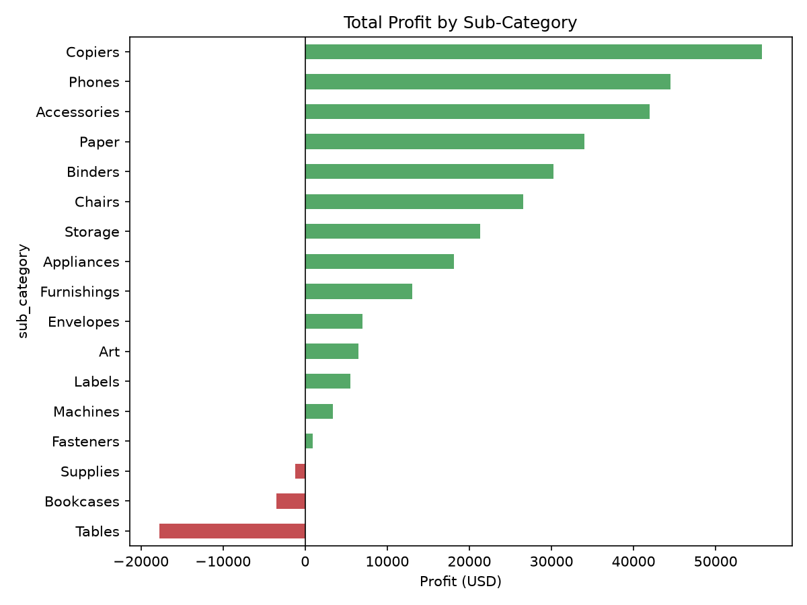
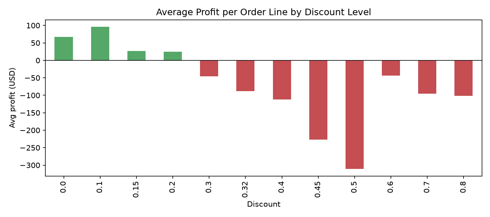

# Sales Data Analysis & Data Quality Check

Data quality checks and exploratory analysis of 9,994 retail orders, using **Python, Pandas and PostgreSQL**, turning raw sales data into business recommendations.



## Problem / Goal
A retail company wants to know **where it makes and loses money**. Before analysing, the data must be checked for quality issues (missing values, duplicates, outliers).

## Tech Stack
- **PostgreSQL**: data storage (`sql/01_load_data.sql`)
- **Python, Pandas**: data cleaning and analysis
- **Matplotlib**: visualisation
- **SQLAlchemy + python-dotenv**: secure database connection (credentials in `.env`, never committed)
- **Jupyter Notebook**

## Data Quality Results
| Check | Result | Action |
|---|---|---|
| Missing values | 0 | none needed |
| Duplicates | 1 hidden duplicate (same order line, different `row_id`) | removed → 9,993 rows |
| Outliers | large sales (Machines, Copiers), negative profits (discounts) | verified as real, kept |
| Data types | dates and money columns loaded as `object` | converted to `datetime` / `float` |

## Key Findings
1. **Furniture has a profit problem:** ≈2.5% margin vs. ≈17% for Technology.
2. **Tables and Bookcases lose money.**
3. **Discounts above 20% destroy profit:** from 30% on, the average order line is unprofitable.
4. **Sales grew ≈50% (2014 → 2017)** with peaks in Sep, Nov and Dec.
5. **Central region:** ≈8% margin vs. ≈15% in the West.



**Recommendation:** cap discounts at 20%, review pricing of Tables/Bookcases, plan for the Q4 peak.

## How to Run
```bash
# 1. Download "Sample - Superstore.csv" (Kaggle: vivek468/superstore-dataset-final)
# 2. Create the database and load the data (adjust the CSV path in the SQL file)
psql -U postgres -c "CREATE DATABASE superstore;"
psql -U postgres -d superstore -f sql/01_load_data.sql
# 3. Install dependencies
python -m venv .venv
.venv\Scripts\activate
pip install -r requirements.txt
# 4. Create a .env file:
#    DATABASE_URL=postgresql+psycopg2://postgres:<password>@localhost:5432/superstore
# 5. Open notebooks/01_sales_analysis.ipynb
```

## What I Learned
- Technical IDs (surrogate keys) can **hide duplicates**, so check on business columns
- An outlier is not automatically an error: **check plausibility first**
- Keep credentials out of code with environment variables

## Next Steps
- Build an interactive Power BI dashboard on the same data
- Analyse whether the Central region's low margin is caused by higher discounts

---

### Kurzbeschreibung (Deutsch)
Datenqualitätsprüfung und explorative Analyse von 9.994 Verkaufsdaten mit Python, Pandas und PostgreSQL. Ein versteckter Duplikat-Datensatz wurde gefunden und entfernt. Die Analyse zeigt, dass Rabatte über 20 % zu Verlusten führen und die Kategorie Möbel (v. a. Tische und Bücherregale) kaum profitabel ist.